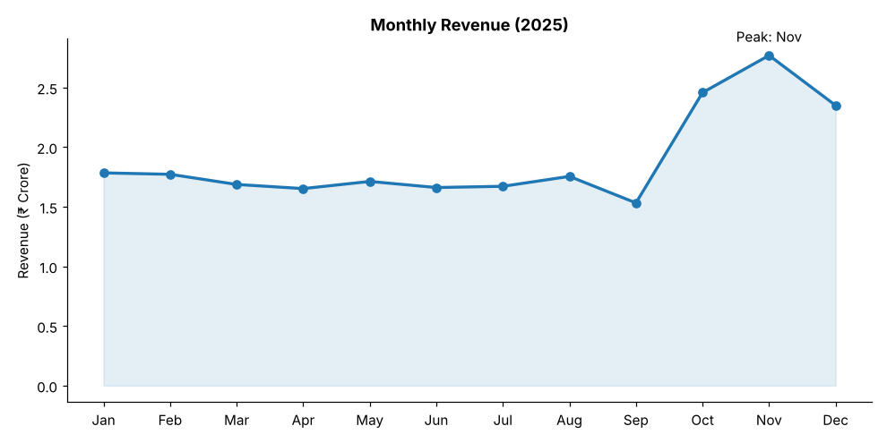
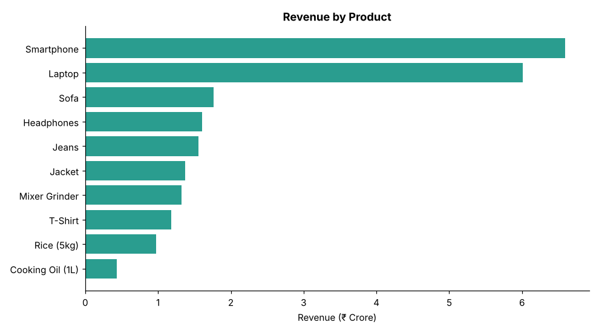
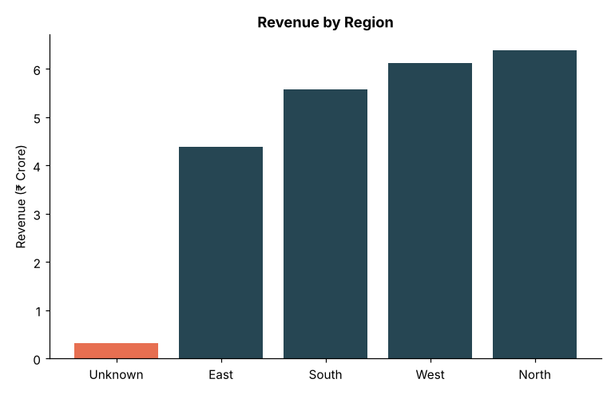
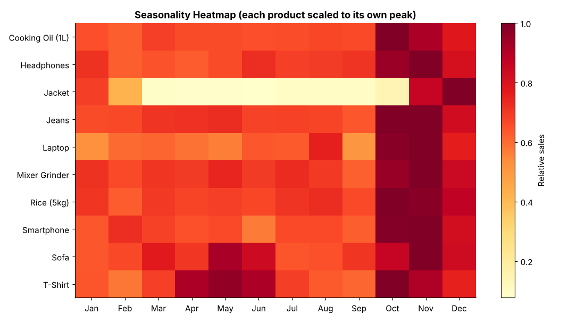
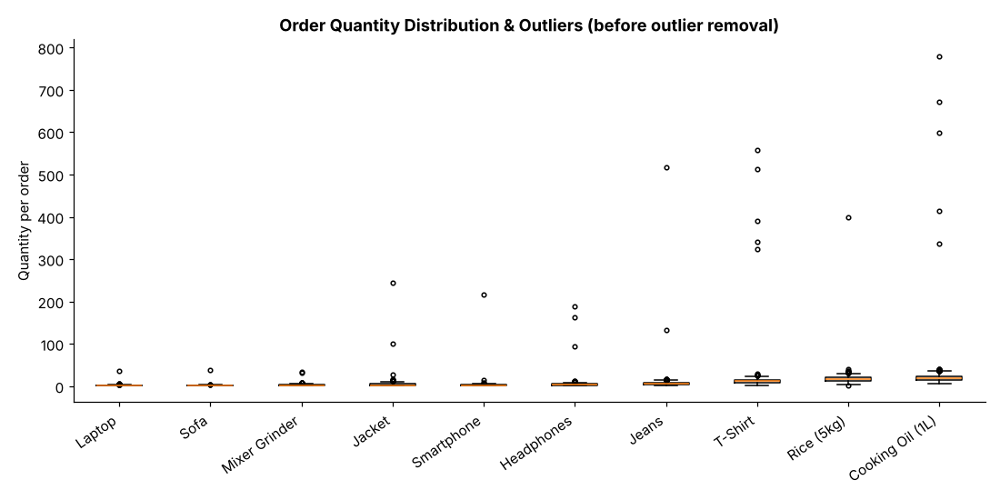
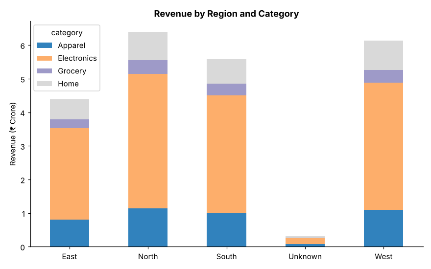
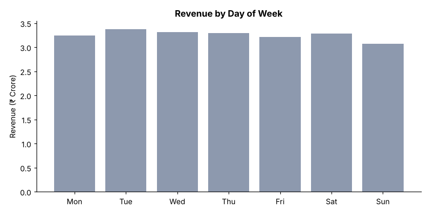

# Exploratory Data Analysis of Retail Sales

**Stack:** Python · Pandas · Matplotlib

## Projects in this repo

| Project | Data | Where |
|---|---|---|
| Retail sales EDA: trends by product, region and month | Synthetic (generated) | This page, below |
| [Amazon sales dataset EDA](amazon-sales-eda/): pricing, discounts, ratings and categories | Real, from Kaggle | [`amazon-sales-eda/`](amazon-sales-eda/) |
| [SQL analysis of customer orders](amazon-sql-analysis/): revenue, repeat customers and top products, with an Excel summary | Real, from Kaggle (review-based orders) | [`amazon-sql-analysis/`](amazon-sql-analysis/) |

---

## Retail Sales EDA

Cleaned and explored a retail sales dataset to identify trends by product, region and month, then visualised key patterns, outliers and potential business insights.

> **Note on data:** The dataset is **synthetic** (generated by `generate_data.py`, seed 42) so the project is fully reproducible. It simulates 10 products, 4 regions and 365 days of 2025, with deliberate data-quality problems injected. Figures below describe this simulated data; to analyse real data, replace `data/raw_sales.csv` with a file that has the same columns and rerun `eda.py`.

## Project structure

```
├── generate_data.py     # builds the messy raw dataset
├── eda.py               # cleaning, analysis, charts
├── data/
│   ├── raw_sales.csv    # 12,160 rows (messy)
│   └── clean_sales.csv  # 11,909 rows (cleaned, outliers removed)
├── figures/             # 7 charts produced by eda.py
├── eda_output.txt       # full printed output of the analysis
└── requirements.txt
```

## How to run

```bash
pip install -r requirements.txt
python generate_data.py
python eda.py
```

## Data cleaning

| Issue | Count | Treatment |
|---|---|---|
| Exact duplicate rows | 120 | Dropped |
| Missing / zero / negative quantity | 106 | Dropped (negative values were mis-logged returns) |
| Missing region | ~181 | Labelled `Unknown` (kept so revenue still counts) |
| Missing discount | ~120 | Assumed 0% |
| Inconsistent text (`north`, `"Laptop "`) | ~2% each | Trimmed and title-cased |
| Dates stored as strings | all rows | Converted to datetime |
| Bulk-order outliers | 25 | Flagged per product (Q3 + 3×IQR), excluded from trend analysis |

Revenue = `quantity × unit_price × (1 − discount)`.

## Key insights

1. **Two products drive over half of revenue.** Smartphones (28.9%) and laptops (26.4%) together make up 55% of the ₹22.8 Cr total, while Electronics as a category is 62%. In contrast, cooking oil sells the most units (~27.9k) but contributes under 2% of revenue. Stock, marketing and margin decisions should be revenue-weighted, not unit-weighted.
2. **The festive season is the whole story for the calendar.** Revenue is flat at ~₹1.7 Cr/month from January to August, dips in September (₹1.53 Cr), then jumps 60% in October and peaks in November (₹2.77 Cr, 1.8× the September low). October and November alone deliver 22.9% of annual revenue from 16.7% of the calendar.
3. **September is a pre-festive lull.** It is the weakest month and falls 12.7% from August. This is the window for inventory build-up rather than heavy promotion.
4. **Seasonal products need their own plan.** 68% of jacket revenue falls in November–January, and t-shirts peak April–June. The heatmap shows each product's own seasonality shape.
5. **East lags in every category.** North (28.0%) and West (26.9%) lead; East holds 19.2%, trailing in each of the four categories rather than just one, which points to a store-footprint or demand issue rather than a product-mix issue.
6. **Discounts did not lift order size.** About 40% of orders carried a discount, yet average quantity per order is ~8 whether the discount is 0%, 5%, 10% or 20%. Discounting cost ~₹0.8 Cr (3.4% of gross sales). Worth testing whether targeted discounts would perform better. *(Caveat: in this synthetic data discounts were assigned independently of quantity, so this result reflects that design. On real data this is a hypothesis to test.)*
7. **Weekday effect is negligible.** Sales are spread almost evenly across the week (13.5–14.8% per day); Sunday is slightly lowest.
8. **Bulk orders are material.** 25 outlier orders (data-entry errors or bulk buyers) account for 6.4% of revenue. They should be verified, or treated as a separate B2B segment, because they distort averages and trends.

## Figures

| | |
|---|---|
|  |  |
|  |  |
|  |  |
|  | |

## Possible next steps

- Forecast monthly revenue with a seasonal model (e.g. SARIMA or Prophet).
- Add margin data to move from revenue-based to profit-based product ranking.
- Customer-level analysis (repeat purchase, basket size) if customer IDs are available.
