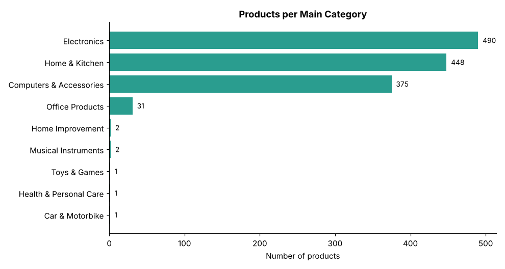
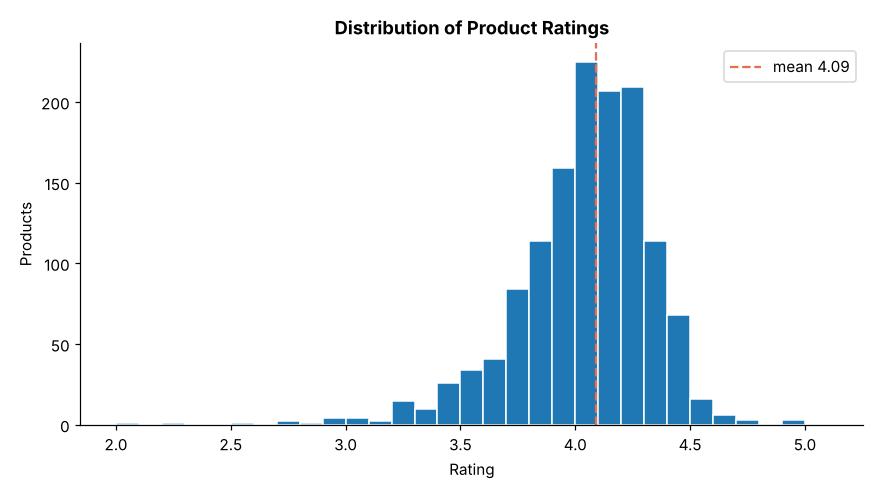
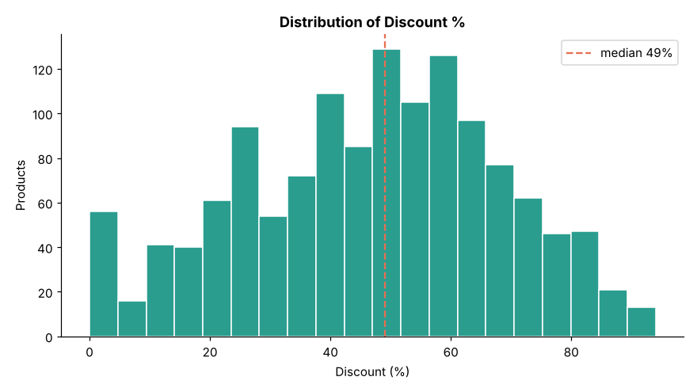
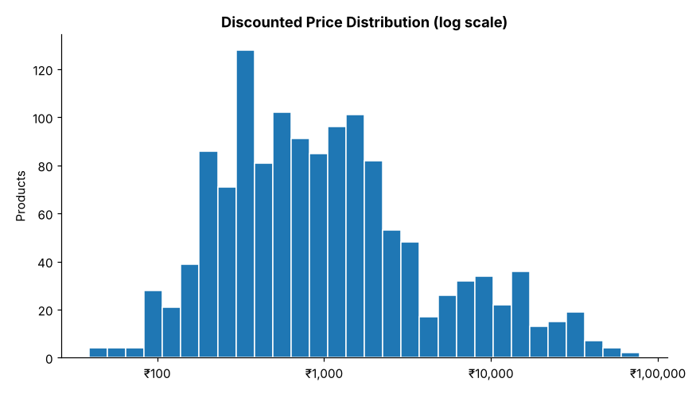
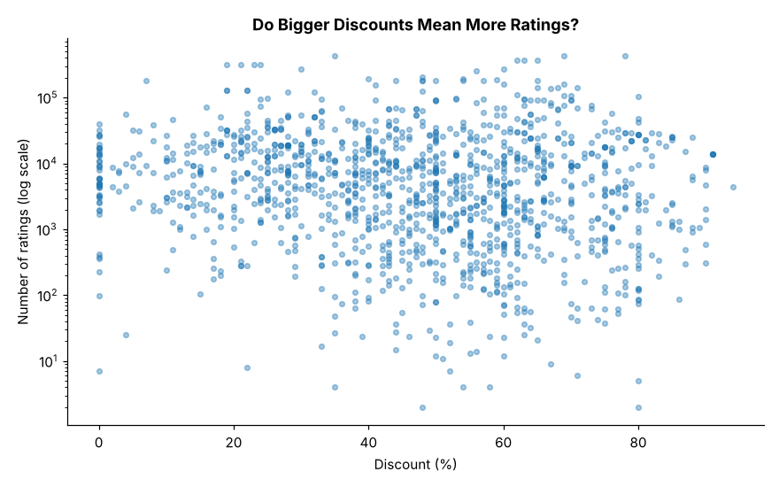
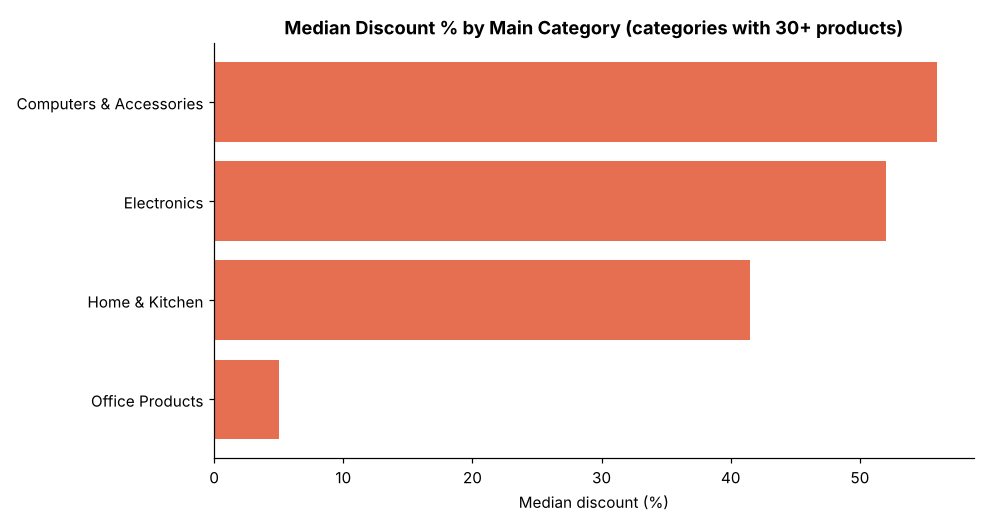
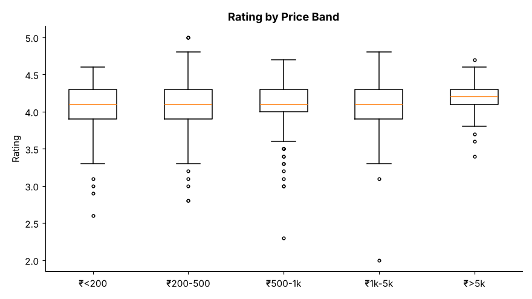
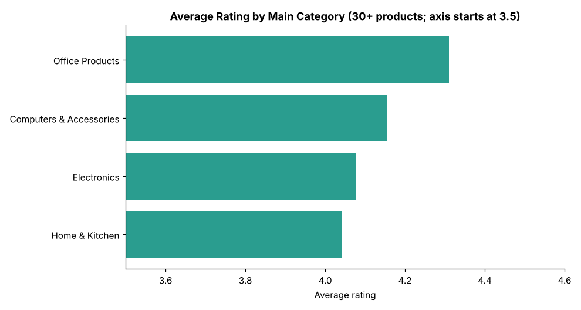

# Exploratory Data Analysis of Amazon Sales Data (India)

**Stack:** Python · Pandas · Matplotlib

Cleaned and explored a dataset of ~1,350 Amazon India product listings to understand pricing, discounting, ratings and category mix, then visualised the key patterns, outliers and business takeaways.

## Data

- **Source:** [Amazon Sales Dataset](https://www.kaggle.com/datasets/karkavelrajaj/amazon-sales-dataset) on Kaggle (by karkavelrajaj), scraped from Amazon India. Licensed **CC BY-NC-SA 4.0**; this repo's `data/clean_products.csv` is a derived, trimmed version and carries the same licence.
- **What it contains:** product, category, discounted and actual price (₹), discount %, rating, rating count and review text. It has **no sales volumes or dates**, so this is an analysis of listings, pricing and customer ratings, not of revenue over time. Rating count is used as a rough popularity signal.
- **To reproduce:** download `amazon.csv` from Kaggle into `data/`, then run:

```bash
pip install -r requirements.txt
python eda.py
```

The raw `amazon.csv` is not committed. The script writes `data/clean_products.csv`, the 8 charts in `figures/`, and prints every number quoted below (saved in `eda_output.txt`).

## Data cleaning

| Issue | Count | Treatment |
|---|---|---|
| Raw rows (one per review) | 1,465 | Collapsed to one row per `product_id` |
| Repeated product IDs | 114 | Kept first row per product → **1,351 products** |
| Prices stored as text (`₹1,099`) | all | Stripped `₹` and commas, converted to numbers |
| Discount stored as text (`64%`) | all | Converted to a number |
| Non-numeric rating (`\|`) | 1 | Set to missing |
| Missing rating count | 2 | Left missing, excluded from rating-count analysis |
| Stated vs recomputed discount | 0 mismatches | Discount column is consistent with the prices |
| Category | 211 distinct paths | Split into main category and sub-category |

## Key insights

1. **Three categories make up 97% of the catalogue.** Electronics (36%), Home & Kitchen (33%) and Computers & Accessories (28%). The other six main categories have 31 products or fewer, so category-level conclusions are only reliable for the big three (and Office Products with 31).
2. **Discounting is the norm.** The median discount is 49% and the mean is 46.7%. Half of all products (49%) are discounted by 50% or more, and 15.6% by 70% or more. The median list price is ₹1,795 against a median selling price of ₹899, so the "actual price" is better read as a reference price than a price shoppers usually pay.
3. **Discount depth varies a lot by product type.** Smartwatches (median 75% off), USB cables (63%) and in-ear headphones (63%) are heavily discounted, while smartphones (25%) and smart TVs (37.5%) are not. Across price bands, items under ₹200 have a median discount of 62% against 31% for items above ₹5,000.
4. **Ratings barely separate products.** The mean rating is 4.09 with a standard deviation of only 0.30; 75% of products are rated 4.0 or higher and just 3% are below 3.5. A 4.1 therefore tells a shopper very little, which makes rating count and review text more useful signals than the star average.
5. **Deeper discounts go with slightly lower ratings, not more ratings.** Average rating falls from 4.17 for products with 0–20% off to 3.97 for those with 81–100% off (correlation −0.16). The number of ratings shows essentially no relationship to discount (Pearson 0.004, Spearman −0.13), so deep discounts are not associated with more popularity in this data. This is an association in scraped listings, not proof that discounting does or doesn't drive sales.
6. **Attention is highly concentrated.** The top 10% of products hold about 61% of all ratings. The most-rated listings are budget accessories: Amazon Basics HDMI cables (about 427k ratings) and boAt Bassheads earphones (about 364k).
7. **The best-regarded products are not the most discounted.** The 231 products (17%) with a rating of 4.3+ and above-median rating counts have a median discount of 41%, compared with 49% across all products. Premium items (above ₹5,000) have the highest average rating (4.17) with relatively modest discounts.
8. **Category quality differs within hardware.** Computers & Accessories has the highest average rating of the three big categories (4.15) and the lowest median price (₹399) despite a 56% median discount. Remote controls (3.80) and in-ear headphones (3.89) are the weakest large sub-categories, a possible quality issue worth investigating.
9. **Outliers are mostly premium TVs and viral accessories.** 141 products have a list price above ₹15,603 (the IQR×3 threshold), led by the Sony Bravia 65" TV at ₹139,900 list (₹77,990 selling). 84 products exceed 60,762 ratings.

### Data caveat worth knowing

About 29% of products (389) share an identical rating count with another listing, which appears to be the same product sold in different variants. Summing rating counts therefore overstates the total (23.8M naive vs 17.9M counting each distinct value once). The 61% concentration figure moves only slightly (60.4%) under that correction, but any total-based metric should be read with this in mind. For the same reason, no "revenue" or "market share" figures are reported.

## Figures

| | |
|---|---|
|  |  |
|  |  |
|  |  |
|  |  |

## Possible next steps

- Text analysis of `review_content` (sentiment, common complaints) for weakly rated sub-categories such as remote controls and in-ear headphones.
- Join with real sales or traffic data to move from listing-level to revenue-level conclusions.
- Model rating or popularity from price, discount and category to see which factors matter once controlled for each other.
